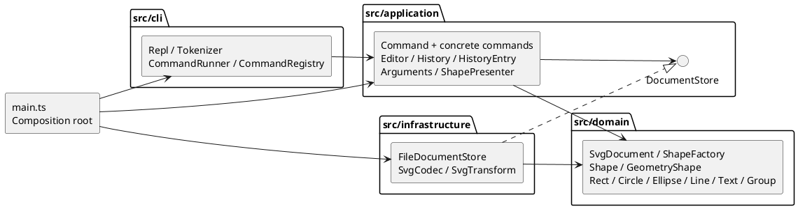

# Lab1 Phase 1：SVG 编辑器实现报告

本报告对应 `phase_cli_1.md`，实现日期为 **2026-10-24（Asia/Shanghai）**。实现范围是 Phase 1 的 TypeScript 面向对象 CLI，不包含后续的 box 插件或 GUI。

## 一、架构方案

### 1. 模块划分

| 模块 | 职责及主要类 |
| --- | --- |
| `src/domain/` | `Shape` 与六种具体图形封装属性和操作；`GeometryShape` 复用几何约束；`Group` 管理子节点；`SvgDocument` 管理树、尺寸、唯一性和重组；`ShapeFactory` 负责实例化 |
| `src/application/` | `Editor` 管理当前文档、路径、事务；`History` / `HistoryEntry` 管理历史；`Command` / `EditCommand` 定义执行协议；`Arguments` 校验参数；`ShapePresenter` 组织文本展示 |
| `src/application/commands/` | 每条命令一个具体类，承担本命令的参数解释和领域操作编排 |
| `src/application/ports/` | `DocumentStore` 定义读写文档的抽象端口 |
| `src/infrastructure/` | `FileDocumentStore` 适配文件系统；`SvgCodec` 适配 XML；`SvgTransform` 将支持的外部变换归一化 |
| `src/cli/` | `Tokenizer` 处理引号；`CommandRegistry` 选取命令；`CommandRunner` 统一错误；`Repl` 接入终端/管道 |
| `src/main.ts` | 组合根，创建对象并注入依赖 |
| `test/` | 领域、命令、SVG、CLI、架构测试；`MemoryStore` 替换文件 IO |
| `fixtures/`、`examples/` | 题目给出的外部 SVG、可回放脚本及 SVG 成品 |

PlantUML 组件图（可编辑源文件：[architecture.puml](architecture.puml)）：



### 2. 设计模式的选择与落地

**Command（题目要求）**：`Command` 定义 `execute`。19 个具体命令类封装各自请求；10 个编辑命令继承 `EditCommand`，由其统一进入 `Editor.edit`。REPL 无需了解每条命令的内部流程。历史恢复交给 Memento，不为每种树结构操作分别编写容易出错的逆操作。

**Composite**：`Shape` 提供 `move/scale/set/clone/children` 等统一协议。叶子通过 `GeometryShape` 操作自身几何，`Group` 在 `move/scale` 中递归调用子节点。`MoveCommand` 和 `ScaleCommand` 不判断 tag。容器 `set` 写自身公共 SVG 样式，子节点按 SVG 规则继承；本阶段不实现 box 的专用属性传播。

**Memento**：`HistoryEntry` 私有保存操作前后的深拷贝，通过 `undo/redo` 返回新的副本。每条编辑先在候选文档中运行，只有完整成功后，才替换当前文档并入栈。即使递归缩放在第二个子节点数值溢出，第一个子节点的修改也不会泄漏到当前文档。`History` 管理撤销栈、重做栈和 IO 屏障。

**Factory**：`ShapeFactory` 在一个注册表中将六种类型映射到构造器。各类通过多态解释创建参数、设置属性、移动、缩放、复制与摘要，不在命令、渲染器或 XML 读写中重复 `switch(tag)`。

**Ports / Adapter（架构方式）**：应用层仅依赖 `DocumentStore` 接口；生产环境注入文件适配器，测试注入内存实现。领域层不访问文件、XML 库或终端。

**两处名字分派及待重构项**：

1. `src/cli/CommandRegistry.ts`：命令名 → Command 实例。后续改为注入命令提供者。
2. `src/domain/ShapeFactory.ts`：图形类型名 → Shape 子类。后续改为 ShapeProvider 注册。

这两处按题目要求标记为后续插件阶段的待重构点。当前的集中注册表并不等于完成了插件系统。XML 词法中对 transform 操作符的解析不是按图形类型分派。

### 3. 依赖方向规则

| 模块 | 可以依赖 | 原因 |
| --- | --- | --- |
| domain | domain | 领域行为独立于应用入口与技术实现 |
| application（含 commands / ports） | application、domain | 命令组织用例，通过端口请求 IO |
| infrastructure | infrastructure、application 的端口、domain | 实现端口并把 XML 转换为领域对象 |
| cli | cli、application | CLI 只分词、调用命令和输出结果 |
| main | 所有生产模块 | 唯一的对象装配入口 |

domain / application 不导入 Node IO 或第三方包。跨层具体依赖视为待处理项，不用类型断言掩盖。`test/architecture.test.ts` 自动检查层间 import、每文件类数量及类名，并禁止 `switch` 分派；对于更细的“infrastructure 只依赖应用端口”规则，另抽查实际 import。

### 4. 变化点假设

| 可能变化 | 留出的边界 / 暂不实现的原因 |
| --- | --- |
| 新图形、复合 box | Shape 多态与集中工厂；保留 data-kind，但插件注册、模板和降级还原协议留到下一阶段 |
| GUI、agent 等入口 | Editor / Command 独立于 readline，可复用同一命令体系；暂不引入事件总线 |
| 其他存储位置或序列化格式 | DocumentStore 端口允许替换；不将文件路径解析放入模型 |
| 更大的文档与更长历史 | 当前每步快照时间/空间约 O(N)，历史 H 步约 O(HN)；可升级为增量 Memento 或结构共享，课程规模不提前优化 |
| 完整 SVG 兼容性 | XML 适配器独立；当前只支持规定类型与静态子集，遇到未知节点拒绝整个读入，避免静默丢失图形 |
| 命令参数与展示文案 | 参数、展示、REPL 各自隔离；暂不引入通用 schema 框架或国际化框架 |

### 5. 题目未完全明确之处的选择

- `init` 无参数为 800×600，仅给宽度时高度为 600；`canvas` 要么无参数，要么提供两个尺寸。
- 宽高/半径允许 0，但不允许负数；画布尺寸和缩放倍率必须大于 0；拒绝 NaN、Infinity、十六进制数字和空数字。
- group 输入成员先按原文档深度优先顺序排序。同父时新组替代首个选中节点的位置；跨父时新组挂根：若首个选中节点本身在根，则占据其根位置，否则追加根末尾。所有成员保留相对顺序，undo 完整恢复原位置。
- `addto` 追加到目标末尾；目标是自身或自己的后代时拒绝。组成员重复、祖先与后代同时入选时拒绝。
- `front` 是同级最后绘制，`back` 是最先绘制。未选中的同级节点相对次序保持。
- 成功保存到显式路径后，该路径成为无参 save 的默认路径；成功 init 清除该路径。
- 显示类不进入历史；只读 `canvas` 不设置屏障；失败的 init/read/save/canvas 不触碰历史或路径。
- undo/redo 输出 `undone:` / `redone:` 加上被撤销/重做的原操作摘要，明确表示操作方向，不承诺与示例逐字一致。
- 普通 g 的 ungroup 是结构解散：子节点提升并占据组位置，组自身样式随组删除；不会替每个子节点计算并固化原继承样式。
- 只有本阶段可创建的普通 g，因此不会创建受插件保护的复合对象。外部 `data-kind="box"` 保留标记但降级成普通 g，不误判为已安装 box 插件。

## 二、过程记录

以下是本次 Codex 实际完成的迭代，不虚构人工发现或不存在的讨论。

| 阶段 | 发现 / 判断 | 实际处理与证据 |
| --- | --- | --- |
| 阅读任务 | 初始目录只有要求文件，没有 Git 仓库；任务明确规定 TypeScript、Command、分步提交和 final tag | 先初始化 Git，提交工程骨架和架构初稿；确认 GitHub 身份后创建私有仓库 |
| 领域建模 | 如果命令直接修改公开属性，会退化成数据袋和过程式分派 | 使用私有属性 Map、受约束 setter、GeometryShape 复用和 Group 多态递归；第一批 4 项测试通过 |
| 历史设计 | 对 group/delete/ungroup 分别写逆操作容易遗漏节点归属和顺序 | 使用候选文档事务和前后快照；补充完整树的撤销恢复断言 |
| 原子性验证 | “先改后校验”会在容器递归处理途中留下部分修改 | 构造第一个子节点可缩放、第二个因 1e308 溢出失败的场景，验证整棵树不变 |
| IO / 词法 | # 既是注释前缀又出现在颜色里；text 内容也可能等于 in；自动补 id 可能撞上后续显式 id | 注释只识别行首；保留 token 引号信息；导入前预扫描并预留所有已有 id |
| 类型检查 | XML 库的 localName 类型允许 null；测试框架的 throws 重载不接受占位 undefined | 给标签名提供 tagName 回退，修正断言重载后再次执行完整检查 |
| 自查修正 | 内部根节点若用普通 id 参与匹配，会错误占用用户的 __root__；仅凭 data-kind 也不能认定插件已经加载 | 根节点有内部标记并从用户身份匹配中排除；未知复合标记按普通 g 处理；两者均新增回归测试 |
| CLI 集成 | 纯交互输出不方便脚本验收 | TTY 显示 svg>，管道只输出命令结果；遇错继续并返回退出码 1；用子进程实际回放两节点图 |
| 架构验收 | 文档中的依赖承诺需要可验证 | 用 TypeScript AST 检查 import 层次、一类一文件及无 switch；测试扩展至 33 项 |

Git 历史保留了工程初始化、领域模型、命令与历史、SVG 与 CLI、测试及文档等阶段。没有将现成的全部代码一次性包装为唯一提交。

## 三、一致性自查

### 1. 实际模块是否与方案一致

一致。初稿规划的 domain / application / infrastructure / cli 均存在，后续细化了 application 的 commands / ports，以及用于几何复用、展示和变换解析的类，没有改变层级方向。

修订记录：增加 `SvgTransform` 作为外部 SVG 几何归一化适配器；将普通容器上的未知 data-kind 明确为降级标记；定义根节点的内部身份语义。以上均记录于本报告过程表及对应代码提交。

生产类一类一文件、文件名与类名相同；Token 和 DocumentStore 是接口文件，main 是组合入口。属性存储、容器成员和历史栈均封装在类中。

### 2. 依赖方向是否违反规则

当前检查未发现违反。具体抽样：

- `MoveCommand` → EditCommand / Arguments / SvgDocument，不导入 CLI、文件系统或 XML。
- `Editor` → domain / History / DocumentStore，不导入 FileDocumentStore。
- `FileDocumentStore` → DocumentStore / SvgDocument / SvgCodec 和 Node 文件 API，符合适配器职责。
- `CommandRunner` → application + CLI 注册表 / 分词器，不访问具体图形和存储实现。
- `Group` → Shape / Value，不依赖命令或终端。

自动检查覆盖整个 src 的 import 边界与类文件规则；类型注册与命令注册两个集中分派点仍是明确登记的后续重构项，不宣称已经插件化。

## 四、质量保证手段

### 1. 可复现检查

```sh
npm ci
npm run check
npm run cli < examples/demo.commands
npm run cli < examples/flowchart.commands
```

`check` = 严格 TypeScript 类型检查（含测试）→ Node 测试 → 编译。启用 strict、noUncheckedIndexedAccess、noImplicitOverride、exactOptionalPropertyTypes。

本地 Node.js v25.9.0，TypeScript 5.9.3，tsx 4.23.15，XML 库 0.9.12。本次执行结果：**33 项测试通过，0 失败；类型检查和构建通过；两份回放成功。** CI 配置在 Node.js 22 / 24 上重现检查与回放，具体远端运行状态以 GitHub Actions 为准。

### 2. 需求与测试对应

| 验收内容 | 主要证据 |
| --- | --- |
| 六种图形、浮点几何、公共/专属属性 | domain / commands 测试逐类校验 move + scale 的坐标与尺寸，验证非法属性与参数 |
| in、group、ungroup、addto、删除与层次 | commands 测试嵌套树、跨父归组、祖先循环、顶层解散限制和前后顺序 |
| undo/redo 粒度、分支与 IO 屏障 | commands 测试单步组合恢复、新编辑清 redo、所有文档命令屏障及显示命令例外 |
| 失败不改变任何状态 | commands 测试失败树比较、失败后仍可 redo、递归中途溢出；SVG 测试失败文件读写 |
| SVG XML、唯一 id、自动补 id | svg 测试预留后续 id、大小写、重复 id、XML 转义、文本空白及 round-trip |
| 真实文件 IO 与路径 | svg 测试临时目录读写、带空格路径、无参 save、写入失败与临时文件清理 |
| REPL / 脚本 | cli 测试子进程回放流程图、报错后继续、退出码、引号与反斜杠 |
| 架构与范式 | architecture 测试 import 方向、一类一文件、无 switch；人工抽查多态调用 |

流程图回放额外验证：保存文件确实可被 XML 编解码器读回，8 个元素齐全，节点移动已撤销，标签更新为“处理数据 v2”。成品保存在 `examples/flowchart.svg`，浏览器可原生预览。

### 3. 已知边界与取舍

- 不是完整 SVG 编辑器：仅处理题目规定的六种图形。未知图形、文本中的 tspan、DTD、CSS style、事件与外部引用拒绝导入，不静默丢弃。
- 数值支持普通十进制及科学记数法；画布尺寸额外接受 px。百分比和其他单位暂不支持。
- 支持组/叶子的 translate 与正数等比 scale，并按课程“位置 + 尺寸”规则归一化；不模拟字体与描边随 transform 缩放的完整视觉语义。旋转、非等比缩放及根元素 transform 明确拒绝。
- 读取保留被动 XML 属性，但 CLI set 仍遵守题目白名单。不会因为导入过 font-size 就开放 set font-size。
- 整文档深拷贝适合课程规模；不宣称适合超大 SVG、无限历史或多人协作。
- 无 box 创建或插件安装流程；`create box` 返回题目规定的 unknown shape type。
- 作业文件未提供截止日期，因此这里只记录实际实现日期和 Git tag，不声称已经核对课程截止时间。
